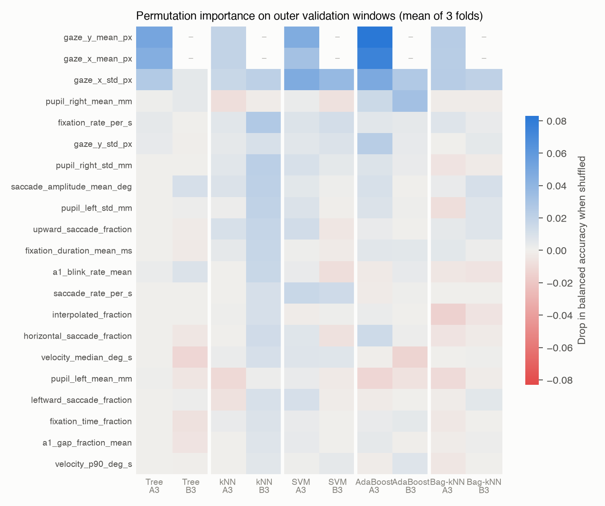
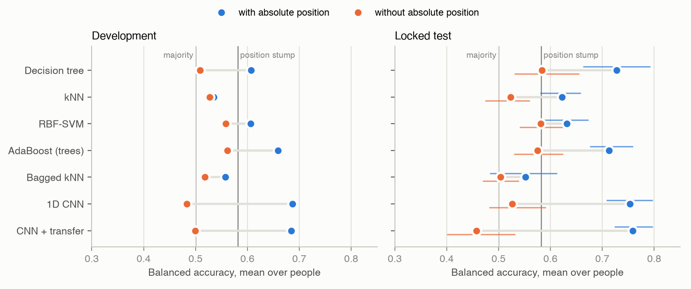
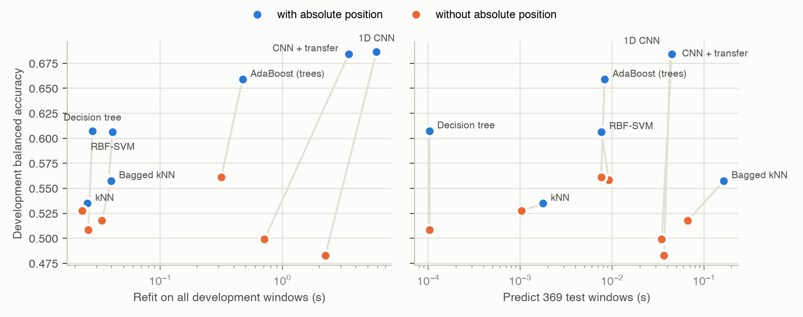

# Assignment 3: Does gaze reveal what code is read, without gaze position?

**Eivind Systad Geiran and Trym Andreas Johnsen** - IT3212 - EMIP eye-tracking dataset

Code and every result file: https://github.com/egeiran/Data-Preprocessing-EMIP, folder
`assignment3/` (`src/` for code, `results/` for evidence, `WORKLOG.md` for the full decision log).

## 1. Problem statement

**Real-world problem.** Eye trackers are moving into consumer devices such as VR/AR headsets,
webcam-based tracking in browsers and remote studies that share raw recordings. Gaze data is
sensitive because it shows what a person looks at and reads. Researchers have proposed that
applications receive only *derived* measures, such as fixations and dwell times within areas of
interest, instead of raw gaze samples, which can identify the user (David-John et al., 2021).
Some platforms do not share the user's eye input with apps at all (Apple, 2026). We test a
simple, position-free version of this idea: keep derived signals such as pupil size, blinks,
eye speed and gaze spread, but withhold absolute screen position. Is that enough to hide what
someone is reading?

**Machine-learning problem.** Binary classification of two-second gaze windows: is a
previously unseen person reading the `vehicle` or the `rectangle` program? Every model is
trained twice:

- **A, with absolute position:** the window features include the mean gaze position on screen.
- **B, without absolute position:** the same features with the mean position removed.

The difference between A and B shows how much of the information lies in *where* people
look rather than *how* they look. Evaluation is on people the model has never seen, using
balanced accuracy averaged with equal weight per person, so that people with long
recordings do not dominate.

**Why this dataset fits.** The EMIP recordings come from a code-comprehension study. Each
participant read both short programs, one after the other, and answered a multiple-choice
question after each (20 started with `rectangle`, 13 with `vehicle`). Because every person
contributes both classes, a model must separate the two programs *within* a person, and
grouped validation by person is possible in every fold. Labels such as expertise or answer
correctness would give one label per person, about 30 examples in total, and they are not
part of the recordings we have.

**Scope.** This is a closed-set study with two known texts and 30 usable people. A weak
result without position would not prove that content cannot leak through other signals,
larger models or more data. The comparison of A and B was planned before any results
existed; using it as the main question and adding the privacy motivation was decided after
the first development results (recorded in `WORKLOG.md`).

## 2. Preprocessing

**Reused from Assignment 1.** Invalid samples (tracker validity, off-screen or exactly-zero
coordinates) are removed. Holes up to 150 ms are linearly interpolated, which covers blinks,
and longer holes stay as gaps. Samples faster than 1,000 deg/s are removed as physically
impossible. A (person, program) pair is kept only with at least 20 s of usable data. The
cleaned 250 Hz samples are cached once, and Assignment 3 never rewrites them.

**Windows.** Each code screen is cut into non-overlapping two-second windows, starting at the
raw screen message. A window never crosses a screen change, and a partial last window is
dropped. Two quality rules are applied:

| Rule | Requirement | Reason |
|---|---|---|
| V1 | >=90% of the 2 s covered by samples, no hole over 150 ms | a summary needs most of its window |
| V2 | additionally >=80% directly measured, not interpolated | interpolated blinks are straight lines, not gaze |

The 80% threshold was fixed from the development quality distribution before any V2 model
was trained. It removes 31 of 992 development windows and no person.

**Split.** The seven test people from Assignment 1's participant split are locked: they were
not used for any choice and were evaluated exactly once, at the end (section 8). The 23
development people (961 windows, 546 vehicle and 415 rectangle) are divided into three outer
folds by person. Inside each outer training set, three inner folds by person choose the
hyperparameters, so an outer validation person never influences a model choice.

**Reproducibility.** The first comparison (V2, made on Linux) was reproduced byte-for-byte on
a second machine and operating system (macOS), where all later stages were run. Only the binary bytes of the cached Parquet tables differ
between machines, so the later stages check data by content fingerprints.

## 3. Feature extraction

**Window summaries (13 features).** For each window:

- mean and SD of gaze x and y
- mean and SD of left and right pupil diameter
- median and 90th-percentile gaze speed, from consecutive samples at most 20 ms apart
- the mean of Assignment 1's trailing blink-rate and gap-fraction signals
- the fraction of interpolated samples

These describe where the gaze is, how spread out it is, how fast it moves and how much
signal is missing. They are cheap to compute and easy to interpret. Mean x and y are the
only absolute-position features; spread, speed and pupil size do not move if the whole
window is shifted on screen.

**Fixation and saccade events (8 features).** The summaries above say nothing about the
structure of reading, so a velocity-threshold detector (I-VT; Salvucci and Goldberg, 2000)
was added:

| Setting | Value | Justification |
|---|---|---|
| speed | centred over three samples | less noise than consecutive-sample speed at 250 Hz |
| threshold | 30 deg/s | common default for screen-based trackers (Olsen, 2012) |
| minimum fixation | 60 ms (15 samples) | shorter fixations are treated as noise by the same source |
| breaks | interpolated sample or interval >20 ms | interpolation would invent smooth fixations |

From the events we compute fixation rate, mean fixation duration, fraction of time in
fixation, saccade rate, mean saccade amplitude, and the share of saccades that are
horizontal, leftward (regressions and line returns) and upward. All eight use coordinate
differences only. To check this, every window was recomputed after shifting it 128 px right
and 64 px up, and every event and feature was identical. The medians look like normal
reading: 3.5 fixations per second, 266 ms per fixation and 92% of the time in fixation.

The resulting feature groups are **A3** (21 features, with position) and **B3** (19 features,
without). Thresholds were fixed in `feature_plan_v3.json` before any distribution or score
was seen.

## 4. Feature selection and dimensionality reduction

**Hand-designed selection.** The A/B design is itself a feature selection: B removes the two
mean-position features to test a specific hypothesis. Identifiers, labels, stimulus names,
timestamps, language and raw eye-position or gaze-vector columns are never given to a model.

**No PCA.** Assignment 1 used PCA on the sample-level data. Here we do not, for two reasons.
First, the feature sets are small (11–21) and each feature has a meaning that we want to
explain. Second, every principal component would mix mean position into the other features,
which would destroy the A/B comparison that the whole study rests on.

**Learned filter selection.** For tree, kNN and SVM, a mutual-information filter
(`SelectKBest`) is part of the training pipeline and keeps k = 5, 10 or all features. k is
tuned jointly with the model's own hyperparameters on inner folds, so no-selection remains a
possible choice. Mutual information was chosen because it is model-agnostic, captures
non-linear dependence and is fitted only on training people. The ensembles do not get the
filter: boosted trees select features at every split, and bagging already draws random
feature subsets.

**What it found.** The inner folds chose k = all in 12 of 18 cases. When k = 5 or 10 won, the
chosen features differed between folds. Mutual information therefore found no small, stable
subset. Mean pupil size was often among the top five. A likely reason is screen luminance or
task order rather than reading behaviour; this is a limitation, not a finding.

*Figure 1. Permutation importance on outer validation windows (drop in balanced accuracy
when one feature is shuffled; mean of three folds; "–" means the feature is not in the
group).* With position, the models rely mostly on mean x and y and on horizontal spread.
Without position, the best models use horizontal spread (roughly line length) and the rates
of fixations and saccades. B therefore still contains relative spatial structure. It is not
purely "how" people look.

## 5. Three algorithms

The data are small and tabular: 961 development windows from 23 people, about 640 in each
outer training set, and 19–21 features in different units (pixels, millimetres, degrees per
second, fractions).

| Algorithm | Why it fits this problem | Tuned values |
|---|---|---|
| Decision tree | splits on single features like the position stump (one split on mean y), so it shows what more than one threshold adds; no scaling across units | depth 2/4/6, minimum leaf 5/10 windows |
| k-nearest neighbours | no assumption about the shape of the classes; tests directly whether windows of the same program lie close together | 5/15/31 neighbours, uniform/distance votes |
| RBF-kernel SVM | non-linear boundary with explicit regularisation, which limits overfitting with few people | C = 0.1/1/10, gamma = 0.01/0.1 |

**Why these values.** Each family has six settings, crossed with the filter's three k values
(section 4). Tree depth runs from 2, one step above the stump, to 6: up to 64 leaves of at
least 10 windows, about what 640 training windows can fill. Odd neighbour counts avoid tied
votes; 5 is local and 31 (about 5% of the training windows) is smooth. C spans strong to weak
regularisation on a log scale, and gamma 0.01/0.1 lies on either side of scikit-learn's default
(1/number of features for standardised data, about 0.05 when all features are kept). The chosen values often sit at
a grid edge (depth 6 and 5 neighbours in 4 of 6 folds each), so the best setting may lie
outside the grid; the grids were declared before the comparison and not widened afterwards.

**Why not the others.** Regression and additive models give each feature a separate effect
unless interactions are added by hand, while the tree and SVM can combine position with
spread; the SVM with small gamma also comes close to a linear boundary. Gaussian Naive Bayes
assumes independent, normally distributed features within each class, but several fractions
pile up at 0 or 1; at least half of the windows have no upward saccade. A neural network is
covered in section 9.

The three have different inductive biases: rules on single features, local similarity in
the full space, and a global smooth margin. This makes their disagreement informative. kNN
and SVM standardise features inside the training pipeline, so validation people never
influence the scaling. Tree and SVM use balanced class weights because vehicle windows are
57% of the data (the vehicle program takes longer to read); scikit-learn's kNN has no such
option. Every family and feature group
gets the same search budget and the same folds, so differences are paired by person.

## 6. Comparison of the three algorithms

Development results are averaged over the 23 people, using each person's prediction from
the outer fold where that person was held out.

| Model | Balanced accuracy, A3 / B3 | Macro-F1, A3 / B3 | Outer-fold range, A3 / B3 |
|---|---|---|---|
| Decision tree | .607 / .509 | .567 / .465 | .573–.657 / .489–.530 |
| kNN | .535 / .528 | .507 / .495 | .491–.614 / .476–.615 |
| RBF-SVM | .607 / .558 | .581 / .528 | .526–.690 / .504–.595 |
| Majority class / position-only stump | .500 / .581 | .352 / .453 | |

**Position carries most of the signal.** A depth-one tree that only sees mean y reaches .581,
about as high as kNN and SVM with every feature. Without absolute position, tree and kNN fall
to near chance. SVM keeps the most (.558), but one of its outer folds is at .504.

**Similar accuracy, different errors.** The stump predicts rectangle for 96% of rectangle
windows but only 17% of vehicle windows, because it learned a single y-threshold. Tree and
SVM with A3 have more even class recalls (.56/.63 and .61/.59). kNN favours the majority
class (vehicle recall .69, rectangle .41).

**Why kNN is weakest with position.** One likely reason is that it is the only one of the three
without class weights, so it under-predicts rectangle, which balanced accuracy penalises. This
is not the whole story: it has the same bias without position, where it beats the tree. Fewer
features did not help either; on the inner folds, keeping five beat keeping all 21 in only one
of three folds. Without position, the three are within .05 of each
other.

**Uncertainty.** Single people range from .44 to .80 (tree, A3) and from .34 to .89 (SVM,
A3), and the person SD is .09–.14. With three folds and 23 people, differences of a few
points between models are not reliable. The first set of features (V2, 13 features) gave
.616/.527 (tree), .584/.498 (kNN) and .582/.534 (SVM). The event features and the filter did
not give a consistent gain.

## 7. Boosting and bagging

Following the assignment, boosting and bagging use different base algorithms: decision
trees for boosting and kNN for bagging.

**AdaBoost with shallow trees (boosting).** The steps:

1. Start with weights that give both classes equal total weight.
2. Fit a shallow tree (depth 1–3) to the weighted windows.
3. Compute its weighted error *e* and its vote weight, learning-rate x log((1-e)/e).
4. Increase the weight of the windows it got wrong, then normalise.
5. Repeat for 200 rounds. The prediction is the weighted vote of all trees.

Boosting suits weak, high-bias learners: one shallow tree barely beats chance, but a sequence
of trees that focuses on earlier mistakes can model interactions. Depth (1/2/3) and learning
rate (0.1/1) are tuned.

**Bagged kNN (bagging).** The steps:

1. Draw a bootstrap sample of the training windows, with replacement.
2. Draw a random subset of the features (50%, 75% or 100%).
3. Fit a scaler and a kNN classifier on that sample and subset.
4. Repeat for 50 members. The prediction is the majority vote.

Bagging reduces variance by averaging models fitted to perturbed data. kNN changes little
under row resampling alone, so the random feature subsets are what make the members differ.
k (15/31) and the feature share are tuned.

**A correction before any result.** The plan first gave the base tree balanced class
weights. That crashed AdaBoost on its first fit: the tree optimised balanced weights while
AdaBoost scored it under uniform weights, so its error could exceed 0.5. The balance was
moved to AdaBoost's starting weights. This change was made and recorded before any ensemble
score existed.

| Model | Balanced accuracy, A3 / B3 | Outer-fold range, A3 / B3 |
|---|---|---|
| AdaBoost (trees) | **.659** / .561 | .648–.672 / .527–.588 |
| Bagged kNN | .558 / .518 | .486–.612 / .487–.553 |

AdaBoost with position is the best development model and also the most stable over folds.
It is .05 above the best single model and .08 above the stump. Bagging helps kNN with
position (.535 to .558) but not without it. Neither ensemble lifts the position-free group
clearly above .56: ensembles extract more from position, not from gaze dynamics.

## 8. Basic vs boosting vs bagging vs transfer

**What "transfer" means here.** The assignment does not define it, so we interpret it as
transfer learning. The CNN from section 9 is first trained on a
*source task* whose label is unrelated to the program shown: is the participant looking at
an instruction screen or at a multiple-choice answer screen? These screens come from the same
recordings, tracker and people, but are never code. The convolution layers are then reused for
vehicle/rectangle in one of two modes, chosen on inner folds:

- **freeze:** the pretrained layers are fixed and only a new output layer is trained;
- **fine-tune:** all layers continue training at a lower learning rate (0.0003).

Pretraining uses only the training people of the current split (255–322 source windows per
inner split, 430–447 per outer split), so no validation or test person leaks in.

**Development comparison** (23 people, outer folds; best single model per group shown as
"basic"):

| Method | With position (A) | Without position (B) | A − B |
|---|---|---|---|
| Basic: best of tree, kNN, SVM | .607 (tree) | .558 (SVM) | .049 |
| Boosting: AdaBoost (trees) | .659 | .561 | .098 |
| Bagging: bagged kNN | .558 | .518 | .040 |
| CNN from scratch | **.687** | .483 | .204 |
| CNN + transfer | .684 | .499 | .185 |
| Controls: majority / position-only stump | .500 / .581 | | |

**Locked test.** Every method was then tuned on all 23 development people, refitted on all 961
development windows and scored once on the seven locked people. One of them (pid 18) has only
vehicle windows, so the two-class metrics use six people; the intervals resample those six
people 10,000 times and are descriptive only.

| Method | With position (A) | Without position (B) | A − B, paired (95% interval) | People with A > B |
|---|---|---|---|---|
| Decision tree | .728 | **.584** | .144 (.029 to .254) | 5 of 6 |
| kNN | .622 | .523 | .099 (.041 to .147) | 5 of 6 |
| RBF-SVM | .632 | .582 | .050 (−.020 to .122) | 4 of 6 |
| AdaBoost (trees) | .713 | .575 | .138 (.077 to .204) | 6 of 6 |
| Bagged kNN | .552 | .504 | .048 (−.010 to .101) | 4 of 6 |
| CNN from scratch | .753 | .527 | .227 (.157 to .289) | 6 of 6 |
| CNN + transfer | **.759** | .458 | .301 (.236 to .379) | 6 of 6 |
| Majority / position-only stump | .500 / .582 | | | |

*Figure 2. Balanced accuracy with (blue) and without (orange) absolute position. Left: 23
development people, outer folds. Right: locked test, six two-class people, with 95%
person-bootstrap intervals. Vertical lines: majority class and the position-only stump.*

The test confirms the development pattern on fresh people. With position, the CNN, the tree and
AdaBoost reach .71–.76. Without position, the best method (tree, .584) only ties the stump that
sees nothing but mean y (.582). Every family is better with position, and for five of the seven
the paired interval excludes zero. Scores with position are higher on test than on development
(CNN .753 vs .687, tree .728 vs .607). Six people cannot tell whether that is luck or easier
recordings, so development remains the main comparison, and no model was re-chosen after the
test.

**Explanation.** Every family gains from absolute position. The gap is about .05 for the basic
models and bagging, .10 for boosting and .20 for the CNN. Without position, the best methods
reach about .56, none reaches the position-only stump (.581), and the CNN falls to chance.
AdaBoost profits because sequential shallow trees combine the position features with spread
and pupil features. The CNN profits most because it sees the whole two-second trajectory on
the screen rather than one mean point. Bagging gives kNN little, because kNN already has low
variance (section 7), and the bagged model leans even more toward vehicle: it finds only about
30% of rectangle windows, against 40% for single kNN. Transfer gives
nothing in either group. The source task is small, and telling instruction from answer
screens is probably also mostly a layout task, so its filters likely add little that the
target task cannot learn directly.

## 9. Convolutional neural network

**Input.** The assignment allows the preprocessed data to be used directly, so the CNN sees
each two-second window as a sequence of 500 time steps (4 ms each) with six channels: gaze x,
gaze y, left and right pupil, a "measured" mask and an "interpolated" flag. A step without a
sample is zero with mask 0, so holes are visible to the network and never squeezed out. For A,
x and y are divided by the screen size; for B, each window's mean x and y is subtracted first,
which removes absolute location but keeps relative movement, mirroring feature group B. Pupil
channels are standardised with statistics from the training people only.

**Architecture.** Three blocks of 1D convolution, batch normalisation and ReLU, with max-pooling
after the first two (f, 2f and 2f channels); then global average pooling, dropout 0.3 and a
linear layer to two classes. This is 8,466 to 95,650 parameters depending on the setting, small
enough for about 640 training windows. The loss is cross-entropy with balanced class weights.

**Tuned hyperparameters and why.**

| Hyperparameter | Values | Reason |
|---|---|---|
| filters f | 16, 32 | capacity; tests whether more feature maps help with this little data |
| kernel size | 5, 9, 15 | the first layer spans 20, 36 or 60 ms, the range of saccade durations; the last block sees 128, 240 or 408 ms, about one fixation and saccade |

Adam (learning rate 0.001), batch size 32, at most 60 epochs and dropout are standard values
and fixed. Training stops when inner-validation balanced accuracy has not improved for 10
epochs, and the outer model is refitted for the median best epoch of the chosen setting. The
search uses the same nested person folds as all other models: six settings x three inner
folds x three outer folds x two groups. Inner scores are somewhat optimistic because the same
inner people also stop training, but outer validation people are never used. Each refit was
repeated with three seeds; seed changes move fold scores by about .02, less than the
differences between folds.

**Results.** With absolute position, the CNN is the best development model (.687; folds
.620–.757). Without it, the CNN is near chance (.483; folds .404–.550). Centred sequences
carry spread, speed, pupil and fixation structure, yet the network finds no reliable
difference between the programs in them. Yet SVM and AdaBoost reach .56 from summary features
of the same windows. About 640 training windows were enough for the CNN to learn the strong
position signal, but are probably too few to learn such a weak one from raw sequences.

## 10. Complexity, computation time and performance

Sizes and times below come from the final models on an otherwise idle laptop (Apple M4):
refit on all 961 development windows (median of five warm repetitions; one timed run for the
CNNs, on four threads) and prediction of all 369 test windows, about 12 minutes of gaze (five
warm repetitions on one CPU thread). Balanced accuracy is development / test.

| Model (A / B) | Size of the fitted model | Refit (s) | Predict 369 windows (ms) | BA with position | BA without position |
|---|---|---|---|---|---|
| Decision tree | 39 / 57 nodes, depth 6 | .03 / .03 | 0.1 / 0.1 | .607 / .728 | .509 / .584 |
| kNN | stores 961 windows | .03 / .02 | 1.8 / 1.0 | .535 / .622 | .528 / .523 |
| RBF-SVM | 737 / 836 support vectors | .04 / .04 | 7.6 / 9.2 | .607 / .632 | .558 / .582 |
| AdaBoost | 200 trees, 2,622 / 1,088 nodes | .47 / .32 | 8.3 / 7.6 | .659 / .713 | .561 / .575 |
| Bagged kNN | 50 x 961 stored windows | .04 / .03 | 164 / 66 | .558 / .552 | .518 / .504 |
| CNN | 24,786 / 8,466 weights | 5.9 / 2.2 | 43 / 37 | .687 / .753 | .483 / .527 |
| CNN + transfer | 24,786 / 8,466 weights | 3.5 / 0.7 + pretraining | 44 / 35 | .684 / .759 | .499 / .458 |

*Figure 3. Development balanced accuracy against refit time (left) and prediction time for the
369 test windows (right), log scale. Lines join each method's two feature groups.*

**Complexity and time.** Time follows model size. A tree predicts by following one path of at
most six splits, so 369 windows take 0.1 ms. kNN and the SVM compare every window with stored
windows or support vectors (1–9 ms). AdaBoost evaluates 200 trees (8 ms). Bagged kNN runs 50
neighbour searches per window, the slowest prediction of the feature models (66–164 ms) for little
or no gain in accuracy. The CNN costs the most to train, seconds against well under a second for the
others, plus a hyperparameter search of one to two minutes per feature group. Search time also
depends heavily on the machine: on the shared laptop during development, with other jobs and a
power-saving mode competing for the CPU, the nested CNN search took almost four hours. The final
tuning of every method, including the CNNs, took under five minutes on the idle machine.

**In terms of the machine-learning problem.** With absolute position, more capacity buys
accuracy: from a one-split stump (.58) to a 39-node tree (.61 / .73), AdaBoost (.66 / .71) and
the CNN (.69 / .75), at a cost that grows from microseconds to seconds. Without position, extra
capacity buys little. On development, a 0.1 ms tree and an 8 ms ensemble reach .51–.56, below
the position stump, and the CNN falls to chance (.48); on test, the tree (.58) is level with the
ensemble and above the CNN (.53). The input keeps only a weak signal, and the CNN, which must
learn its own summaries from about 640 windows, probably has too little data to find it
(section 9).

**In terms of the real-world problem.** Computation is no barrier for anyone holding gaze data.
Every model classifies 12 minutes of gaze in under 0.2 s on one CPU thread, and even the CNN
trains in seconds, so content inference from shared recordings is cheap. What matters is which
signals are shared. With raw coordinates, a 39-node tree identifies the program for new people
well above chance, and a small CNN does better still. With coordinates withheld, every method
dropped to or below the level of a single threshold on mean position, and the CNN to chance. In this
setting, withholding absolute position removed most of the content signal. But the derived signals
that remain (horizontal spread, pupil size) still gave .56–.58 for several models, so they are not
information-free. Pupil size is also known to reveal cognitive load and emotional arousal
(David-John et al., 2021), and with more texts, people or data a stronger model might find more.

## Conclusion

On new people, eye-tracking windows reveal which of two programs is being read, but almost all of
that information lies in *where* people look. With absolute gaze position, a CNN reaches .69 on
development and .75 on the locked test, and simple models reach .61–.73. Without it, the best
methods reach about .58, no better than a single rule on mean position, and the CNN falls to
chance. Event features, feature selection, ensembles and transfer learning did not change this.
For gaze-data privacy, withholding raw coordinates removed most of the content signal in this
closed two-program setting, though the derived signals are not entirely free of it.

## Limitations

- **Two known texts, 30 people.** This is a closed-set study. A weak result without position
  does not prove that no information leaks with more texts, more data or other models.
- **Layout and luminance.** The two programs differ in length and shape on screen. Position and
  pupil features can reflect layout and screen brightness rather than reading.
- **Task order.** 20 of 33 people read `rectangle` first, so time-related drift (fatigue, pupil
  change) is slightly confounded with the label.
- **B is not purely dynamic.** It still contains relative spatial structure such as horizontal
  spread, which tracks line length.
- **Reused development people.** The same 23 people informed the V1, V2 and V3 choices. Nested
  folds limit the optimism from tuning, but only the locked test people are truly fresh.
- **Six test people.** The test intervals are wide, and pid 18 has only one class.
- **Transfer interpretation.** Our reading of "transfer" may differ from what the course intends.

## References

1. EMIP Workshop. *Distributed Collection of Eye Movement Data in Programming: Dataset*.
   https://emipws.org/dataset/ (accessed 14 September 2026)
2. David-John, B., Hosfelt, D., Butler, K. and Jain, E. (2021). A privacy-preserving approach
   to streaming eye-tracking data. *IEEE Transactions on Visualization and Computer Graphics*,
   27(5), 2555–2565. https://doi.org/10.1109/TVCG.2021.3067787
3. Apple (2026). *Eyes, Hands & Privacy*. https://www.apple.com/legal/privacy/data/en/eyes-hands/
   (updated 14 September 2026, accessed 3 November 2026)
4. Salvucci, D. D. and Goldberg, J. H. (2000). Identifying fixations and saccades in
   eye-tracking protocols. *Proceedings of the 2000 Symposium on Eye Tracking Research &
   Applications (ETRA)*, 71–78.
5. Olsen, A. (2012). *The Tobii I-VT Fixation Filter: Algorithm description*. Tobii Technology.

## AI declaration

AI assistants, including Claude (Anthropic), were used for writing and checking code, for the
figure and export scripts, and for drafting and editing the report text. Every method choice
was fixed in a plan file before results existed, every number in this report is read from the
committed result files, and the authors checked the choices, numbers and interpretations.
